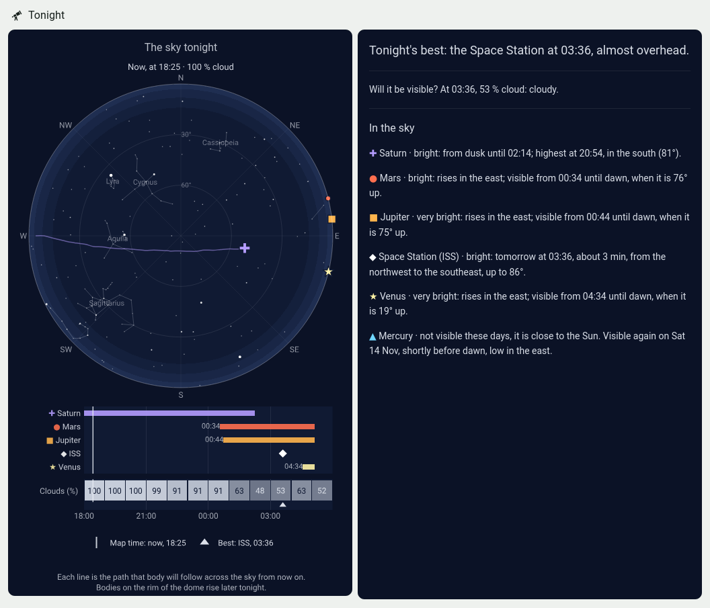
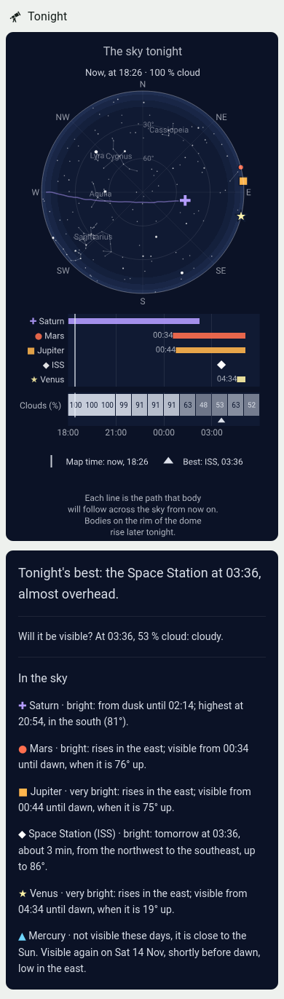

# Tonight — a sky card for Home Assistant

What can I see in the sky tonight, when, and where do I look?

This is a dashboard section for Home Assistant that answers that for people who
are not astronomers: a map of tonight's sky, a timeline of when each planet and
bright satellite is visible, the cloud forecast hour by hour, and the same
information as plain sentences.





*The sky over the Teatro Nacional in San José, Costa Rica.*

It is a **recipe, not a HACS card**: three small Python scripts that feed three
sensors, and a ready-made dashboard section. Installing it is three steps of
copy and paste, about ten minutes. There is nothing to configure: the location
and time zone are the ones Home Assistant already has.

## What it shows

- **The sky dome.** The whole sky as you would see it lying on your back:
  the centre is straight overhead, the rim is the horizon, north is up and east
  is to the right. It has the 390 brightest stars, 15 well-known constellations,
  the Moon, the five naked-eye planets and any bright satellite passing.
- **One moment at a time.** When it is dark the dome shows the sky *now*.
  Before dark it shows the best moment of the coming night. A body that is up
  has a line showing where it will travel; a body that rises later sits on the
  rim where it will appear.
- **A timeline.** One row per body, with a bar while it can be seen, so
  "when?" is answered at a glance. Satellite passes are diamonds.
- **Clouds.** The forecast cloud cover for every hour of the night, on the
  same time axis.
- **Plain sentences.** "Tonight's best: Saturn, almost overhead at 20:56, in
  the south", then one line per planet and per satellite pass, and when each
  missing planet will be visible again.
- **Satellites.** The International Space Station, the Chinese station
  Tiangong, the Hubble telescope and a BlueBird satellite, when they make a
  bright, high pass.

English and Spanish are included. Times are 24-hour.

## What you need

- Home Assistant with a dashboard that uses the **Sections** view, and your
  location set in Settings → System → General.
- Two custom cards, both installable from [HACS](https://hacs.xyz):
  [Plotly Graph Card](https://github.com/dbuezas/lovelace-plotly-graph-card) and
  [card-mod](https://github.com/thomasloven/lovelace-card-mod).
- A way to put files in Home Assistant's `/config` folder (the File editor,
  Samba or SSH add-ons all work).

## Install

### 1. Copy the scripts

Copy the `sensors` folder of this repository to `/config/tonight_sky/sensors/`
on Home Assistant. There is nothing in it to edit.

### 2. Add the sensors

Add the contents of [`configuration.example.yaml`](configuration.example.yaml)
to your `configuration.yaml`. If you already have a `command_line:` section,
add the three `- sensor:` entries to it instead of repeating the heading.

Check the configuration (Developer tools → YAML → Check configuration) and
restart Home Assistant. You should now have three entities:

| Entity | State | Updated |
|---|---|---|
| `sensor.tonight_sky` | Planets visible tonight | Hourly, computed locally |
| `sensor.tonight_satellites` | Visible passes found | Every 2 hours, from N2YO |
| `sensor.tonight_clouds` | Cloud cover this hour (%) | Hourly, from Open-Meteo |

### 3. Paste the card

1. Open [`cards/tonight_section.en.yaml`](cards/tonight_section.en.yaml)
   (or [`.es.yaml`](cards/tonight_section.es.yaml) for Spanish) and copy all of it.
2. In your dashboard choose **Edit dashboard** and add a new section.
3. Open the section's menu (⋮) and choose **Edit in YAML**.
4. Replace everything there with what you copied, and save.

That is all. The card shows planets, the Moon, stars and clouds straight away.

### Optional: satellites

Satellite passes come from [N2YO](https://www.n2yo.com/api/), which needs a
free API key. Register there, then add one line to Home Assistant's
`secrets.yaml`:

```yaml
n2yo_api_key: "YOUR-KEY"
```

The passes appear at the sensor's next update (within two hours, or restart).

## How it decides

- **Night** runs from the end of civil twilight to the start of it at dawn
  (Sun 6° below the horizon).
- **A planet is visible** while it is at least 10° above the horizon during the
  night. Uranus and Neptune are left out.
- **A satellite pass is listed** if it is the ISS, or if it is brighter than
  magnitude 3 and climbs to at least 25°. At most five passes a night.
- **Tonight's best** is the highest, brightest thing in the clearest hour: a
  clear hour beats a cloudy one, a bright satellite pass beats a planet, a
  brighter planet beats a fainter one.
- **Brightness words:** very bright (magnitude −1 or less), bright (up to 1),
  medium brightness (up to 2.5), faint.

Planet and Moon positions are computed on your Home Assistant with Paul
Schlyter's [low-precision formulas](https://stjarnhimlen.se/comp/ppcomp.html),
no internet needed. Checked against JPL's DE421 ephemeris at 10° N, the planets
were within 0.03° over a year of samples and the Moon within about 0.1°.

## Good to know

- **Where it has been used.** This was adapted from a Spanish card that runs
  daily at 10° N on Home Assistant 2026.11, on desktop and in the iPhone app.
  The English version has been rendered in Firefox only. The sensor script
  runs for other latitudes (near the poles it reports "it does not get dark
  tonight"), but the card has only been looked at from the tropics. Reports
  from elsewhere are welcome.
- **Constellations** were picked to read well from the tropics. All bright
  stars are drawn everywhere; only 15 constellations have lines and names.
- **Your browser's clock** must be in the same time zone as the location.
- **Satellite brightness is rough.** N2YO gives a magnitude for the ISS and
  Hubble; for Tiangong and BlueBird it is estimated from distance.
- **Layout.** The card assumes Home Assistant's sidebar and a section two
  columns wide. If the dome looks too small or too large, adjust `GEOM` in
  `build_card.py` and rebuild (see below).
- **Location.** The scripts read it from Home Assistant's own settings file
  (`.storage/core.config`). To use another place, put a `config.json` beside
  the scripts; `sensors/settings.py` shows its contents. The card draws the
  stars for Home Assistant's location.
- **Recorder.** The sensors carry long attributes. You may want to exclude the
  three entities from the recorder.
- **Offline.** The cloud and satellite sensors keep their last good answer, so
  the card survives an internet outage.

## Changing things

The files in `cards/` are written by `build_card.py`. To change the card, edit
that script, run `python3 build_card.py` (needs PyYAML) and paste the new file
over the old section.

- **Satellites:** the list is `SATS` in `sensors/satellites.py` (NORAD number,
  standard magnitude, height). Give a new one a name in `LANG[...]['sats']` and
  a colour in `SAT_C` in `build_card.py`, then rebuild.
- **Another language:** copy one block of `LANG` in `build_card.py` and
  translate it. Pull requests are welcome.
- **Colours and symbols:** `BODY` and `SAT_C` in `build_card.py`. The current
  set was checked for colour-blind separation on the dome's night blue, and
  every planet also has its own shape.

## Data and credits

| What | Source | Terms |
|---|---|---|
| Star positions and magnitudes | [HYG database](https://codeberg.org/astronexus/hyg) v4, from Hipparcos | CC BY-SA 4.0 |
| Constellation lines | [Stellarium](https://github.com/Stellarium/stellarium-skycultures) modern sky culture | CC BY-SA |
| Planet and Moon formulas | Paul Schlyter, [stjarnhimlen.se](https://stjarnhimlen.se/comp/ppcomp.html) | — |
| Satellite passes | [N2YO](https://www.n2yo.com/api/) | Free API key, 100 requests an hour |
| Cloud forecast | [Open-Meteo](https://open-meteo.com) | Free for non-commercial use, CC BY 4.0 |

Your coordinates are sent to N2YO and Open-Meteo to get passes and clouds for
your location.

## Licence

The code is under the [MIT licence](LICENSE). `stars.json` is derived from the
HYG database and Stellarium and is under
[CC BY-SA 4.0](https://creativecommons.org/licenses/by-sa/4.0/).
