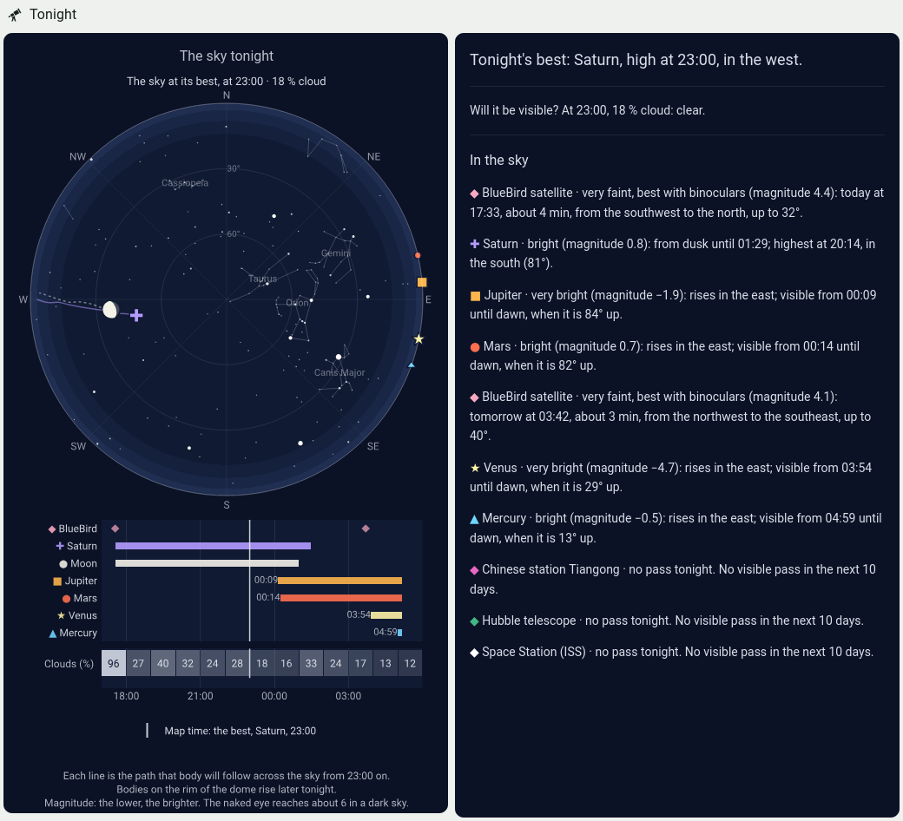
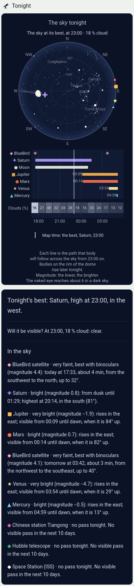

# Tonight — a sky card for Home Assistant

What can I see in the sky tonight, when, and where do I look?

This is a dashboard section for Home Assistant that answers that for people who
are not astronomers: a map of tonight's sky, a timeline of when each planet and
bright satellite is visible, the cloud forecast hour by hour, and the same
information as plain sentences.

*The sky over the Teatro Nacional in San José, Costa Rica.*

It is a **recipe, not a HACS card**: a few small Python scripts that feed three
sensors, and a ready-made dashboard section. Installing it is three steps of
copy and paste, about ten minutes. There is nothing to configure and no
account to create: the location and time zone are the ones Home Assistant
already has.

Every calculation is explained, with how it was checked, in
[How it works](docs/how-it-works.md).

## What it shows

- **The sky dome.** The whole sky as you would see it lying on your back:
  the centre is straight overhead, the rim is the horizon, north is up and east
  is to the right. It has the 390 brightest stars, 15 well-known constellations,
  the Moon with its phase, the five naked-eye planets and any satellite passing.
- **One moment at a time.** When it is dark the dome shows the sky *now*.
  Before dark it shows the best moment of the coming night. A body that is up
  has a line showing where it will travel; a body that rises later sits on the
  rim where it will appear.
- **A timeline.** One row per body, with a bar while it can be seen, so
  "when?" is answered at a glance. Satellite passes are diamonds.
- **Clouds.** The forecast cloud cover for every hour of the night, on the
  same time axis.
- **Plain sentences.** "Tonight's best: Saturn, almost overhead at 20:56, in
  the south", then one line per planet and per satellite pass in order of
  appearance, and when each planet or satellite that is missing tonight will
  be visible again, the soonest first.
- **How bright.** Every planet and pass says it in words and as a magnitude:
  "very bright (magnitude −1.9)", "very faint, best with binoculars
  (magnitude 4.6)".
- **Satellites.** The International Space Station, the Chinese station
  Tiangong, the Hubble telescope and a BlueBird satellite. Their passes are
  computed on your Home Assistant from public orbit data: no API key.
- **Starlink trains (optional).** The row of lights a new batch of Starlink
  satellites makes in its first days, when one passes over you.

English and Spanish are included. Times are 24-hour.

## What you need

- Home Assistant with a dashboard that uses the **Sections** view, and your
  location set in Settings → System → General.
- Two custom cards, both installable from [HACS](https://hacs.xyz):
  [Plotly Graph Card](https://github.com/dbuezas/lovelace-plotly-graph-card) and
  [card-mod](https://github.com/thomasloven/lovelace-card-mod).
- A way to put files in Home Assistant's `/config` folder (the File editor,
  Samba or SSH add-ons all work).

## Install

### 1. Copy the scripts

Copy the `sensors` folder of this repository to `/config/tonight_sky/sensors/`
on Home Assistant. There is nothing in it to edit.

### 2. Add the sensors

Add the contents of [`configuration.example.yaml`](configuration.example.yaml)
to your `configuration.yaml`. If you already have a `command_line:` or an
`automation:` section, add the entries to it instead of repeating the heading.
The automation recalculates the sky sensor the minute the night ends, so the
card moves on to the coming night at dawn.

Check the configuration (Developer tools → YAML → Check configuration) and
restart Home Assistant. You should now have three entities:

| Entity | State | Updated |
|---|---|---|
| `sensor.tonight_sky` | Planets visible tonight | Hourly and at dawn, computed locally |
| `sensor.tonight_satellites` | Visible passes found | Every 2 hours, computed locally from CelesTrak's orbits |
| `sensor.tonight_clouds` | Cloud cover this hour (%) | Hourly, from Open-Meteo |

### 3. Paste the card

1. Open [`cards/tonight_section.en.yaml`](cards/tonight_section.en.yaml)
   (or [`.es.yaml`](cards/tonight_section.es.yaml) for Spanish) and copy all of it.
2. In your dashboard choose **Edit dashboard** and add a new section.
3. Open the section's menu (⋮) and choose **Edit in YAML**.
4. Replace everything there with what you copied, and save.

That is all. The card shows planets, the Moon, stars, clouds and satellite
passes straight away.

### Optional: Starlink trains

The last `- sensor:` block in the example, `sensor.tonight_trains`, finds
Starlink trains. It downloads a 5 MB file from CelesTrak three times a day,
and most weeks there is no train, so it is left to you. Without it the card
simply shows no trains.

### Upgrading from an earlier version

1. Copy the `sensors` folder again: it now also has `orbits.py`, `trains.py`
   and the `sgp4` folder.
2. In `configuration.yaml`, set `command_timeout: 120` on the satellite sensor
   and add the automation (and the trains sensor, if you want it).
3. Paste the new card over the old section.
4. The `n2yo_api_key` line in `secrets.yaml` is no longer used; you can delete it.

## How it decides

- **Night** runs from the end of civil twilight to the start of it at dawn
  (Sun 6° below the horizon).
- **A planet is visible** while it is at least 10° above the horizon during the
  night. Uranus and Neptune are left out.
- **A satellite can be seen** while the Sun lights it, it is at least 10° up
  and your sky is dark enough. Every ISS pass is listed; the other satellites
  when they reach 15° and are brighter than magnitude 5.5. At most five passes
  a night. A satellite with no pass tonight says when its next one is, looking
  10 days ahead.
- **Tonight's best** is the highest, brightest thing in the clearest hour: a
  clear hour beats a cloudy one, a bright satellite pass beats a planet, a
  brighter planet beats a fainter one.
- **Brightness words:** very bright (magnitude −1 or less), bright (up to 1),
  medium brightness (up to 2.5), faint (up to 4), very faint, best with
  binoculars. Lower magnitudes are brighter.

In short (details in [How it works](docs/how-it-works.md)):

- **Planets and the Moon** are computed on your Home Assistant with Paul
  Schlyter's [low-precision formulas](https://stjarnhimlen.se/comp/ppcomp.html),
  no internet needed. Checked against JPL's DE421 ephemeris at 10° N, the
  planets were within 0.03° over a year of samples and the Moon within about
  0.1°.
- **Satellite passes** are computed with the SGP4 orbit model from
  [CelesTrak](https://celestrak.org)'s public orbit data. Compared with N2YO
  for four days, the times agreed within seconds and the heights within 0.2°.
- **Satellite brightness** comes from distance and the angle at which the
  satellite is lit. Compared with [Heavens-Above](https://www.heavens-above.com)
  on 198 passes, it was within 0.1 magnitude on average (worst 0.25).

## Good to know

- **Where it has been used.** This was adapted from a Spanish card that runs
  daily at 10° N on Home Assistant 2026.11, on desktop and in the iPhone app.
  The English version has been rendered in Firefox only. The sensor script
  runs for other latitudes (near the poles it reports "it does not get dark
  tonight"), but the card has only been looked at from the tropics. Reports
  from elsewhere are welcome.
- **Constellations** were picked to read well from the tropics. All bright
  stars are drawn everywhere; only 15 constellations have lines and names.
- **Your browser's clock** must be in the same time zone as the location.
- **Satellite brightness is an estimate.** It matches Heavens-Above closely,
  but real satellites can flare for a few seconds, and a pass low in the sky
  looks dimmer than its figure.
- **Layout.** The card assumes Home Assistant's sidebar and a section two
  columns wide. If the dome looks too small or too large, adjust `GEOM` in
  `build_card.py` and rebuild (see below).
- **Location.** The scripts read it from Home Assistant's own settings file
  (`.storage/core.config`). To use another place, put a `config.json` beside
  the scripts; `sensors/settings.py` shows its contents. The card draws the
  stars for Home Assistant's location.
- **Recorder.** The sensors carry long attributes. You may want to exclude
  them from the recorder (see the end of the example configuration).
- **Offline.** The scripts keep their last good data, and satellite passes are
  recomputed from the stored orbits for up to a week, so the card survives an
  internet outage.

## Changing things

The files in `cards/` are written by `build_card.py`. To change the card, edit
that script, run `python3 build_card.py` (needs PyYAML) and paste the new file
over the old section.

- **Satellites:** the list is `SATS` in `sensors/satellites.py` (NORAD number,
  standard magnitude, days ahead). Give a new one a name in `LANG[...]['sats']`
  and a colour in `SAT_C` in `build_card.py`, then rebuild.
- **Another language:** copy one block of `LANG` in `build_card.py` and
  translate it. Pull requests are welcome.
- **Colours and symbols:** `BODY` and `SAT_C` in `build_card.py`. The current
  set was checked for colour-blind separation on the dome's night blue, and
  every planet also has its own shape.

## Data and credits

| What | Source | Terms |
|---|---|---|
| Star positions and magnitudes | [HYG database](https://codeberg.org/astronexus/hyg) v4, from Hipparcos | CC BY-SA 4.0 |
| Constellation lines | [Stellarium](https://github.com/Stellarium/stellarium-skycultures) modern sky culture | CC BY-SA |
| Planet and Moon formulas | Paul Schlyter, [stjarnhimlen.se](https://stjarnhimlen.se/comp/ppcomp.html) | — |
| Satellite orbits | [CelesTrak](https://celestrak.org) GP data and supplemental Starlink data | Free, no key |
| Orbit model | [`sgp4`](https://pypi.org/project/sgp4/) by Brandon Rhodes, included in `sensors/sgp4/` | MIT |
| Cloud forecast | [Open-Meteo](https://open-meteo.com) | Free for non-commercial use, CC BY 4.0 |

Your coordinates are sent only to Open-Meteo, for the cloud forecast.
CelesTrak is asked for orbits, which are the same for everybody; the passes
over you are computed on your Home Assistant.

## Licence

The code is under the [MIT licence](LICENSE). `stars.json` is derived from the
HYG database and Stellarium and is under
[CC BY-SA 4.0](https://creativecommons.org/licenses/by-sa/4.0/). The `sgp4`
library in `sensors/sgp4/` keeps its own MIT licence (`sensors/sgp4/LICENSE`).
